

  

<h3 align="center">
  <samp>&gt; Hey there! I'm <b><a href="https://lauanmo.github.io/portfolio/">Lauan Moreira</a></b></samp>
</h3>

  <samp>「 Full stack developer building web and mobile apps, REST APIs and AI integrations 」</samp>

  
  
  

  

  <a href="https://lauanmo.github.io/portfolio/"><b>Portfolio</b></a>
  &nbsp;|&nbsp;
  <a href="https://github.com/LauanMO?tab=repositories"><b>Projects</b></a>
  &nbsp;|&nbsp;
  <a href="mailto:moreiralauanpro@gmail.com"><b>Contact</b></a>

  

  

  <a href="https://lauanmo.github.io/portfolio/"></a>

  <a href="https://github.com/LauanMO/MandaRim"></a>
  <a href="https://github.com/LauanMO/Alexandria"></a>
  <a href="https://github.com/LauanMO/Circula"></a>

  <a href="https://mandarim-seven.vercel.app">MandaRim demo</a>
  &nbsp;·&nbsp;
  <a href="https://vortexlm.vercel.app">Circula demo</a>
  &nbsp;·&nbsp;
  <a href="https://github.com/LauanMO/gym_api">Gym API</a>

  <a href="https://github.com/LauanMO?tab=repositories">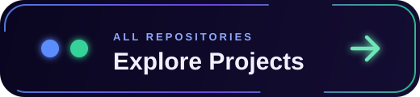</a>

  

  

  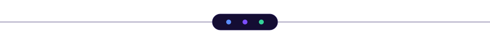

## 🛠 Technologies, Projects and Focus Areas

<table>
<tr>
<td width="420" valign="top" align="center">

<h3>🛠 Technologies</h3>
 

<table align="center">
  <tr>
    <td align="center"></td>
    <td align="center"></td>
    <td align="center"></td>
    <td align="center"></td>
    <td align="center"></td>
  </tr>
  <tr>
    <td align="center"></td>
    <td align="center"></td>
    <td align="center"></td>
    <td align="center"></td>
    <td align="center"></td>
  </tr>
  <tr>
    <td align="center"></td>
    <td align="center"></td>
    <td align="center"></td>
    <td align="center"></td>
    <td align="center"></td>
  </tr>
  <tr>
    <td align="center"></td>
    <td align="center"></td>
    <td align="center"></td>
    <td align="center"></td>
    <td align="center"></td>
  </tr>
</table>

</td>
<td width="230" valign="top" align="center">

<h3>🧪 Projects</h3>
 

<a href="https://github.com/LauanMO?tab=repositories"></a>

</td>
<td width="230" valign="top" align="center">

<h3>🧭 Focus Areas</h3>
 

<a href="https://lauanmo.github.io/portfolio/#stack"></a>

</td>
</tr>
</table>

  

### 📊 Stats

  

  

  

  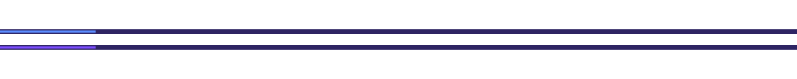

<table width="100%">
<tr>
<td width="33%" valign="top">

<h2>🤝 Open to</h2>

<ul>
  <li>Internships and junior developer roles</li>
  <li>Back-end and full stack projects</li>
  <li>Mobile apps with React Native</li>
  <li>AI integrations in real products</li>
</ul>

</td>
<td width="34%" align="center" valign="middle">

<a href="mailto:moreiralauanpro@gmail.com"></a>

</td>
<td width="33%" valign="top" align="center">

<h2>📫 Contact</h2>

 

  

  

</td>
</tr>
</table>

  

  ⚡ Building web, mobile and AI-powered apps from Fortaleza, Brazil

  Star ⭐ the repos if they helped you!

  Dividers adapted from <a href="https://github.com/HiradEmami/readme-ux-kit">readme-ux-kit</a> (MIT).

  

